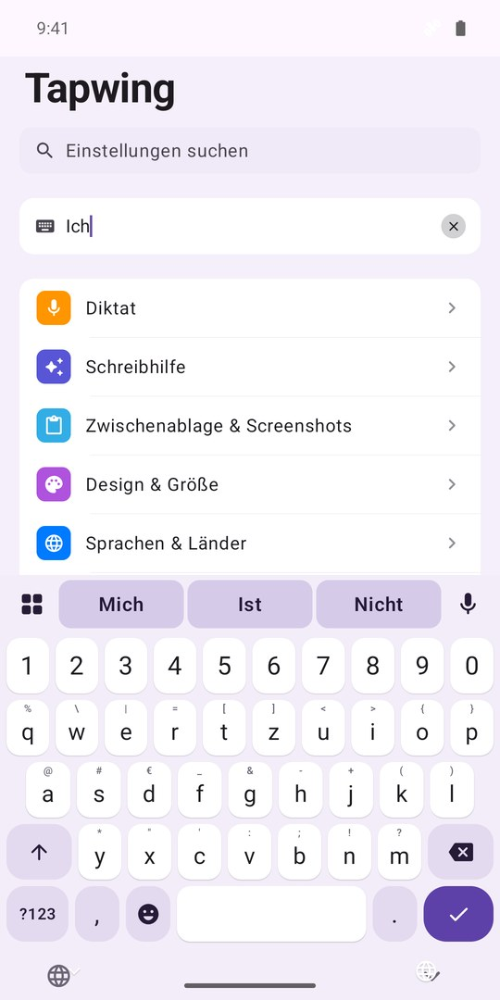
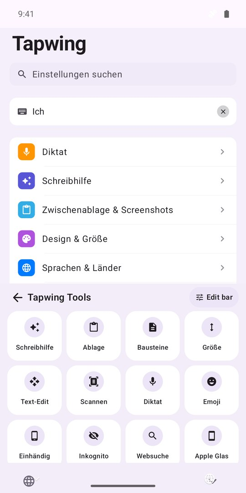

<div align="center">


# Tapwing

**Schnelle, datenschutzfreundliche Android-Tastatur mit Offline-Diktat, lokaler KI-Schreibhilfe und Text-Scan.**


-307D5D?style=flat-square)

[Google Play · Geschlossener Test](https://play.google.com/apps/testing/com.tapwing.keyboard) · [Screenshots](#screenshots) · [Funktionen](#funktionen) · [Datenschutz](#verarbeitung-und-datenschutz) · [Build](#lokal-bauen) · [English](docs/README.en.md)

</div>

---

> Tapwing `2.9.0` (`versionCode = 17`) unterstützt Android 10 bis Android 16+ (`arm64-v8a`) und ist für Google Play (inkl. 16-KB-Seiten-Alignment) vorbereitet.

## Screenshots

| Tippen (QWERTZ) | Diktat & Offline-Modelle | Werkzeuge & OCR |
| :---: | :---: | :---: |
|  |  |  |
| **Themes & Glas-Modus** | **Zwischenablage** | **Schreibhilfe & API-Tresor** |
|  |  |  |

---

## Funktionen

| Bereich | Beschreibung |
| :--- | :--- |
| **Tippen & Vorschläge** | Deutsch (`QWERTZ`, optional mit Umlautreihe & Schweizer Layout), Englisch (`QWERTY`), `AZERTY`. Layout-gewichtete Autokorrektur, Proactive Undo per Antippen, Wisch-Tippen (Glide) und lokales Wortlernen. |
| **Offline-Diktat & Bereinigung** | Lokale Spracherkennung über **Sherpa-ONNX** (**NVIDIA FastConformer**, **Nemotron**, **Parakeet**, **Kroko**, **Canary**) oder **Whisper** – kombiniert mit lokaler Bereinigung von Füllwörtern, Stottern, Selbstkorrekturen, Satzzeichen und Aufzählungen. Android-Spracherkennung und optionale Cloud-APIs sind ebenfalls nutzbar. |
| **Schreibhilfe (Offline & Cloud)** | Sofortiges lokales Korrekturlesen, Umformulieren und Tonfall-Anpassen per eingebauten Regeln, nachladbaren GGUF-Modellen (mit automatischem Speicher-Unload nach 120 s Inaktivität) oder opt-in Cloud-Anbietern mit eigenem API-Key. |
| **Zwischenablage & OCR** | Konfigurierbare Aufbewahrung (`1 Std.` bis `Nie`), automatische Ausklammerung sensibler Eingaben & OTP-Codes, Live-Kamera-OCR (ML Kit) und Einzelbild-OCR über Androids System-Auswahl (**ohne Medien-/Speicherberechtigungen**). |
| **Wörterbuch & Bausteine** | SHA-256-verifizierte Offline-Wörterbücher (`FrequencyWords`), Import/Export als `.zip` (kompatibel mit Gboard-Exporten), `.txt`, `.csv`/`.tsv`, `.json` sowie Textkürzel wie `/datum` oder `/zeit`. |
| **Oberfläche & Barrierefreiheit** | Klare modulare Einstellungen mit Suchleiste, Glas-Modus, Live-Höhenregler (`75%–135%`), WCAG-AAA-Kontrastoption, großer Tastenbeschriftung, Einhand-/Split-Layout und Inline-Autofill (Android 11+). |

### Neu in `2.9.0`
- **CE-Speichertrennung & AndroidKeyStore:** Persönliche Profildaten (`PersonalProfileStorage`), API-Keys, Zwischenablage, Wörterbücher und Tippstatistiken liegen strikt im erst nach Entsperrung zugänglichen CE-Storage; Direct-Boot greift niemals auf persönliche Profildaten zu.
- **Opt-in & Sensible Felder:** Automatische Profilerkennung ist standardmäßig deaktiviert (`Opt-in`-Dialog); Passwort-, Kreditkarten-, OTP- und Inkognito-Felder sowie `IME_FLAG_NO_PERSONALIZED_LEARNING` werden strikt ignoriert.
- **Keine Galerie-Berechtigung:** `READ_MEDIA_IMAGES` und `READ_EXTERNAL_STORAGE` wurden komplett entfernt.
- **SHA-256-Verifikation & Cloud-Einwilligung:** Alle 17 lokalen Modelle und 9 Wörterbuchpakete werden vor Entpackung/Aktivierung per exakter Bytegröße und SHA-256-Prüfsumme verifiziert. Cloud-Diktat und Cloud-Schreibhilfe erfordern je Anbieter eine ausdrückliche Einwilligung (jederzeit widerrufbar unter *Einstellungen → Datenschutz & Cloud-Einwilligung*).

---

## Erste Schritte

1. Tapwing über den [geschlossenen Google-Play-Test](https://play.google.com/apps/testing/com.tapwing.keyboard) installieren oder [lokal bauen](#lokal-bauen).
2. In Android unter *System → Bildschirmtastatur* **Tapwing** aktivieren und als aktive Tastatur wählen.
3. Im integrierten Testfeld ausprobieren; für schnelles Offline-Diktat unter **Diktat** ein empfohlenes Sherpa-ONNX-Modell herunterladen.

## Verarbeitung und Datenschutz

Alle Kernfunktionen verarbeiten Eingaben **100 % lokal auf dem Gerät**. Es gibt weder Werbung noch Analyse-Tracker. Cloud-Funktionen sind deaktiviert, bis du explizit einen Anbieter freigibst und einen eigenen API-Key hinterlegst. Details stehen in der [Datenschutzerklärung](PRIVACY_POLICY.md).

## Lokal bauen

Voraussetzungen: **JDK 17 oder 21**, **Android SDK 36**, **Build-Tools 36.0.0** (Release-Ziel-ABI: `arm64-v8a` für kompakte Bundles mit nativer `Sherpa-ONNX`- und `llama.cpp`-Inferenz).

```bash
./scripts/check-docs-version.sh
./gradlew :app:assembleDebug :app:testDebugUnitTest :app:lintDebug :app:assembleDebugAndroidTest
```

Release-APK & signiertes Play-Store-AAB bauen:

```bash
./scripts/build-release.sh
```

Mehr zu den Architekturdetails in [ARCHITECTURE_ANALYSIS.md](ARCHITECTURE_ANALYSIS.md), zu Lizenzen in [docs/licensing.md](docs/licensing.md) und zum Store-Release in [PLAY_STORE_GUIDE.md](PLAY_STORE_GUIDE.md).

## Lizenz & Mitwirken

Fehler und Vorschläge können über [GitHub Issues](https://github.com/mixxermannipro/tapwing-keyboard/issues) gemeldet werden; Hinweise für Beiträge stehen in [CONTRIBUTING.md](CONTRIBUTING.md) (DCO `Signed-off-by`).
Tapwing ist **Open Source (`GPL-3.0-or-later`)** gemäß [LICENSE](LICENSE), mit einer Zusatzerlaubnis für Google ML Kit / Google Play services in [LICENSE-EXCEPTION.md](LICENSE-EXCEPTION.md) (historische Basis bis einschließlich Commit `299dc28b80e791e750cff20ff10694b031d6604e` zusätzlich unter Apache-2.0; Markenregeln in [TRADEMARKS.md](TRADEMARKS.md), Details in [docs/licensing.md](docs/licensing.md) und [REUSE.toml](REUSE.toml)).
