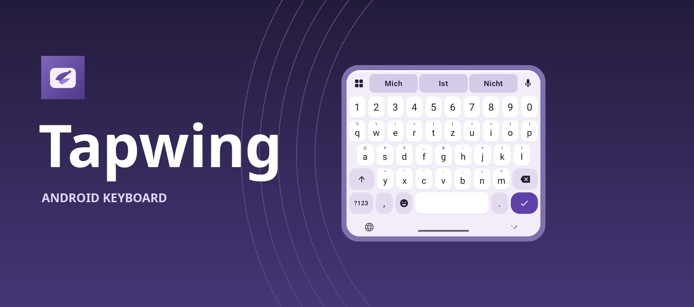
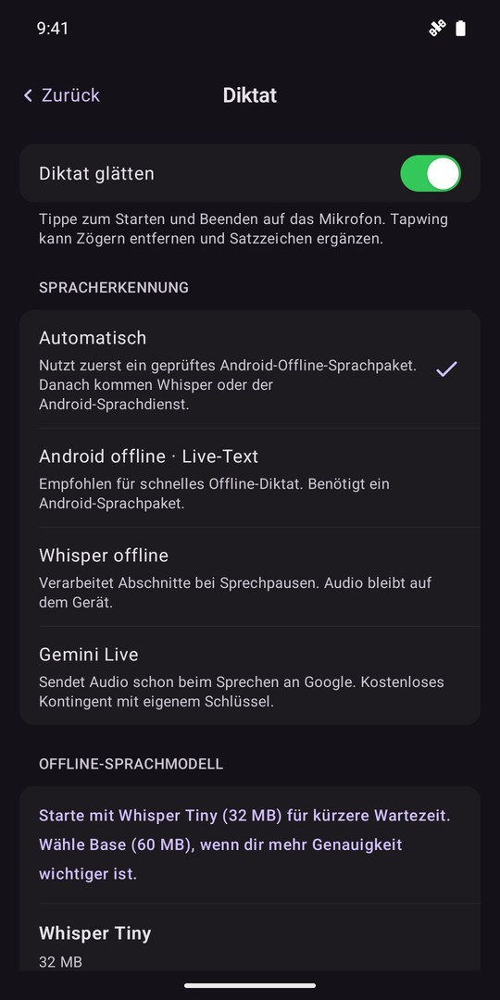
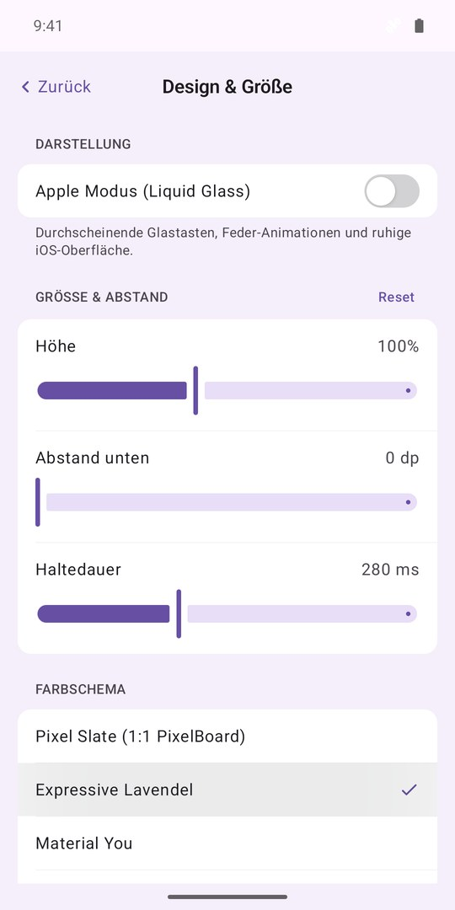
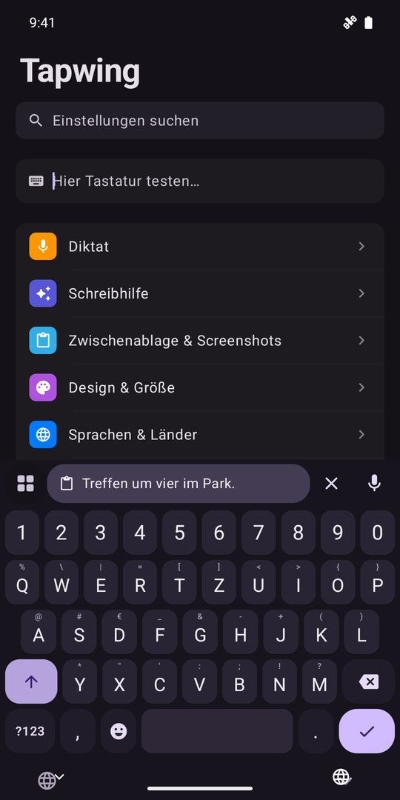
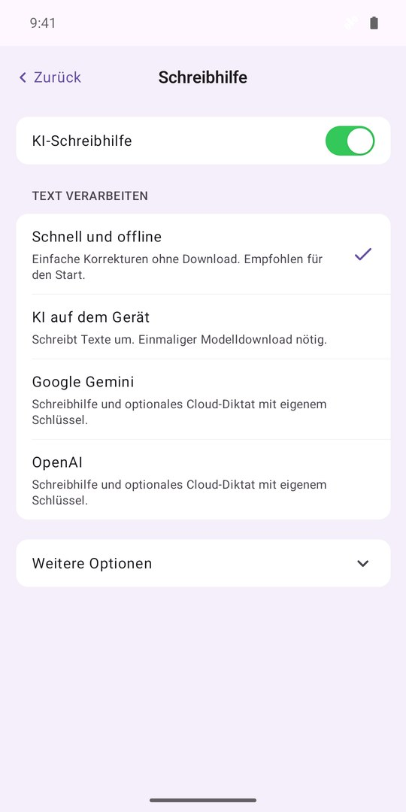

<div align="center">



# Tippen, diktieren und Text bearbeiten

Tapwing verbindet Wortvorschläge, Spracheingabe, Schreibhilfe und eine anpassbare Werkzeugleiste. Schreiben, Lernen und viele Werkzeuge laufen direkt auf deinem Gerät.


[Google Play · Geschlossener Test](https://play.google.com/apps/testing/com.tapwing.keyboard) · [Screenshots](#screenshots) · [Funktionen](#funktionen) · [Datenschutz](#verarbeitung-und-datenschutz) · [Build](#lokal-bauen) · [English](docs/README.en.md)

</div>

> [!NOTE]
> Tapwing 2.2.0 ist im geschlossenen Google-Play-Test. Der Installationslink setzt einen freigeschalteten Testerzugang voraus.

## Screenshots

Echte Aufnahmen von Tapwing 2.2.0 auf einem Android-16-Emulator mit Beispieldaten.

| Tippen | Diktat | Werkzeuge |
| :---: | :---: | :---: |
|  |  |  |

| Design | Zwischenablage | Schreibhilfe |
| :---: | :---: | :---: |
|  |  |  |

## Funktionen

| Bereich | Was du damit tun kannst |
| --- | --- |
| **Tippen** | Zwischen Sprache und Layout wechseln, per Wischgeste tippen, Folgewörter übernehmen und Autokorrekturen zurücknehmen. Tapwing lernt Wortpaare auf dem Gerät und kann Vorschläge pro App anpassen. |
| **Diktat** | Per Android-Sprachdienst oder lokal mit Whisper diktieren. Mit einem unterstützten Android-Offline-Sprachpaket erscheint der Text beim Sprechen. Whisper kann fertige Abschnitte in deutlichen Sprechpausen verarbeiten. |
| **Schreibhilfe** | Text korrigieren, kürzen und umformulieren. Die Optionen umfassen eingebaute Regeln, herunterladbare lokale Sprachmodelle und Cloud-Dienste mit eigenem Schlüssel. |
| **Zwischenablage** | Kopierte Texte direkt einfügen, häufig genutzte Einträge anheften und die Aufbewahrung einstellen. Kopierte Bestätigungscodes können kurz zum Einfügen angeboten werden. |
| **Text scannen** | Text mit der Kamera oder aus einem einzeln ausgewählten Foto erkennen und ins Schreibfeld übernehmen. |
| **Wörterbuch und Textbausteine** | Offline-Wörterbücher herunterladen, eigene Wörter importieren und exportieren sowie Kürzel wie `/datum` oder eigene Textbausteine einsetzen. |
| **Layout und Schnellleiste** | Höhe, Design und Schnellaktionen anpassen. Einhand- und geteiltes Layout stehen zur Auswahl. Das Steuerkreuz hilft beim Navigieren, Markieren und Kopieren. |
| **Weitere Werkzeuge** | Rechnungen wie `24*7=` im Eingabefeld lösen, Tippstatistiken ansehen und Android-Autofill (automatisches Ausfüllen durch den gewählten Dienst) ab Android 11 nutzen. |

### Neu in 2.2.0

- **Live-Diktat:** Android-Offline-Diktat zeigt Text beim Sprechen. Whisper kann in Sprechpausen bereits abgeschlossene Abschnitte verarbeiten. Für optionales Cloud-Streaming steht Gemini Live zur Verfügung.
- **Wortvorschläge:** Ein Tipp auf einen Vorschlag setzt das Wort mit Leerzeichen ein und zeigt passende Folgewörter an.
- **Einfügevorschläge:** Kopierter Text kann direkt in der Vorschlagsleiste erscheinen. Private Felder und von Android als sensibel markierte Clips werden ausgefiltert.

## Erste Schritte

1. Tapwing über den [geschlossenen Google-Play-Test](https://play.google.com/apps/testing/com.tapwing.keyboard) installieren oder [lokal bauen](#lokal-bauen).
2. Tapwing öffnen und über **Aktivieren** in den Android-Tastatureinstellungen einschalten.
3. Über **Auswählen** zu Tapwing wechseln und im Testfeld tippen.
4. Für Diktat unter **Spracheingabe** eine Methode wählen. Android offline braucht ein passendes System-Sprachpaket. Für Whisper das gewünschte Modell in Tapwing herunterladen.

## Verarbeitung und Datenschutz

| Auswahl | Was mit den Daten passiert |
| --- | --- |
| **Tippen, Wörterbuch, Zwischenablage und Texterkennung** | Die Verarbeitung findet auf dem Gerät statt. Der Inkognito-Modus setzt Lernen und Zwischenablage-Verlauf aus. |
| **Android offline und Whisper** | Audio wird auf dem Gerät verarbeitet. Sprachpakete und herunterladbare Modelle müssen vorher verfügbar sein. |
| **Android-Sprachdienst** | Abhängig von Gerät und Sprachdienst kann die Erkennung eine Internetverbindung nutzen. |
| **Gemini Live** | Wenn du den Modus mit eigenem Schlüssel einrichtest, sendet Tapwing Audio während des Diktats an Google. |
| **Cloud-Diktat und Cloud-Schreibhilfe** | Beim separaten Cloud-Diktat geht die Aufnahme nach dem Stopp an den gewählten Anbieter. Bei optionaler Cloud-Textbearbeitung wird der zu bearbeitende Text übertragen. |

Tapwing enthält keine Werbung oder Analyse-SDKs. Die [Datenschutzerklärung](PRIVACY_POLICY.md) erklärt Berechtigungen, Speicherorte und Löschmöglichkeiten.

## Lokal bauen

Voraussetzungen sind **JDK 21**, **Android SDK 36** und **Build-Tools 36.0.0**. Der Gradle-Wrapper liegt im Projekt. Android Studio kann den SDK-Pfad in `local.properties` eintragen. Alternativ setzt du dort `sdk.dir=/pfad/zum/Android/sdk`.

```bash
./gradlew :app:assembleDebug :app:testDebugUnitTest :app:lintDebug
```

Die installierbare Debug-Datei liegt unter `app/build/outputs/apk/debug/app-debug.apk`. Für signierte APK- und AAB-Dateien beschreibt der [Play-Store-Leitfaden](PLAY_STORE_GUIDE.md) die Einrichtung. Das Skript `./scripts/build-release.sh` schreibt seine Ausgaben nach `dist/`.

## Projektstruktur und Dokumentation

| Pfad | Inhalt |
| --- | --- |
| [`app/src/main/`](app/src/main/) | Android-Tastatur, Compose-Oberfläche, Diktat, Wörterbuch, Schreibhilfe und Texterkennung |
| [`app/src/test/`](app/src/test/) | Tests für Sprachverarbeitung, Vorschläge, Wischgesten, Zwischenablage und weitere Kernfunktionen |
| [`docs/play-store/`](docs/play-store/) | Store-Texte und Hinweise für die Play Console |
| [`ARCHITECTURE_ANALYSIS.md`](ARCHITECTURE_ANALYSIS.md) | Technischer Hintergrund zu Tastatur, KI und Android-Schnittstellen |

Fehler und Vorschläge kannst du auf [GitHub Issues](https://github.com/mixxermannipro/tapwing-keyboard/issues) melden. Tapwing steht unter der [Apache-Lizenz 2.0](LICENSE).
